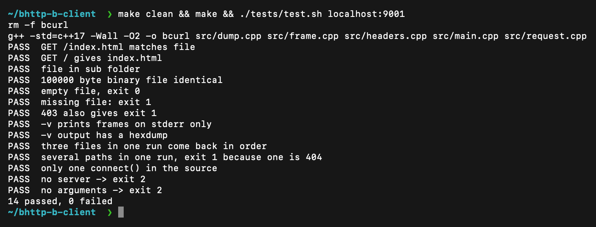
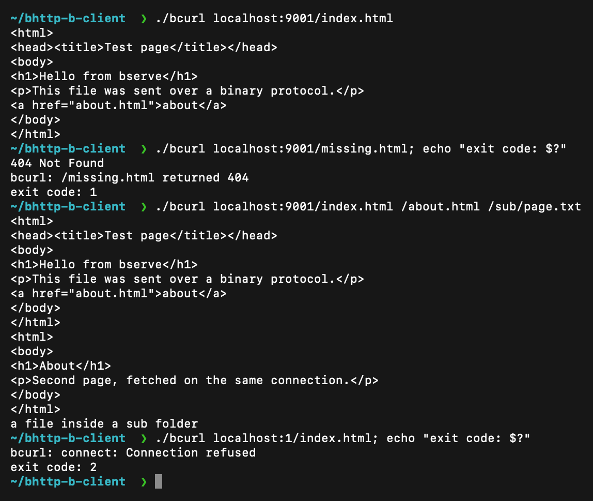
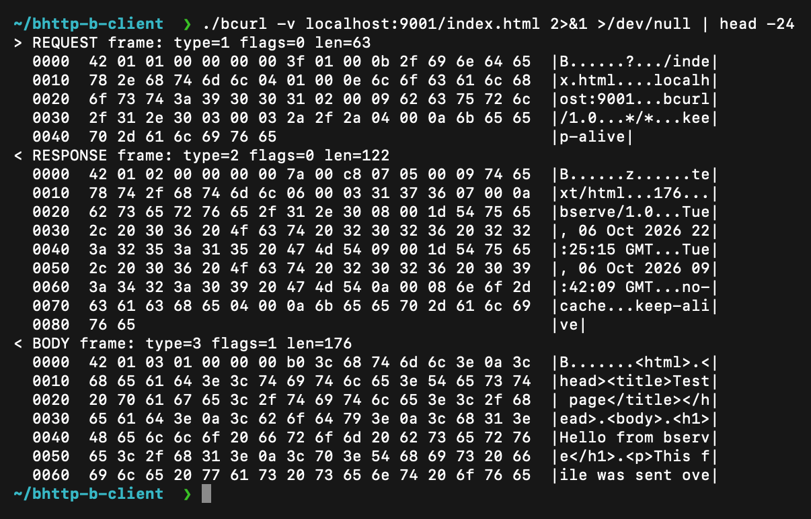

# bcurl (BHTTP-B client)

The client part of our course project "HTTP in binary". It builds a binary request frame for BHTTP-B, reads the
response and writes the body to stdout. The protocol is described in `SPEC.md`, and `HEXDUMP.md` has one request
and response with every byte explained. The client is written only from the spec, so it should work with any
server that follows it, not just ours.

## Build and run

    make
    ./bcurl localhost:9001/index.html
    ./bcurl -v localhost:9001/index.html
    ./bcurl localhost:9001/index.html /about.html

- the body goes to stdout, so `./bcurl localhost:9001/big.bin > big.bin` saves a file
- `-v` prints every frame that is sent and received to stderr, as one line and a hexdump
- paths after the first one are fetched on the same connection, the client never opens a second one
- if there is no port in the address, 80 is used

Exit code: 0 if every response is below 400, 1 if there was a 4xx or 5xx, 2 if it could not connect or the
response was broken.

## How it works

The client connects once. For each path it builds one REQUEST frame: the 8 byte header (magic `B`, version 1,
type, flags, length) and then the method GET, the path and the headers `host`, `user-agent`, `accept` and
`connection`. It reads frames until it gets a BODY with the LAST flag, checks the status in the RESPONSE and
writes the BODY payload to stdout. Frames of unknown types are skipped.

## Code

| File | What is in it |
|------|---------------|
| `src/main.cpp` | arguments, address, the one connect, loop over the paths |
| `src/request.cpp` | builds the request frame, reads the response |
| `src/headers.cpp` | header field encoding, reading the status, static table |
| `src/frame.cpp` | reading and writing whole buffers |
| `src/dump.cpp` | the `-v` output and the hexdump |
| `tests/test.sh` | tests |
| `www/` | copy of the server files, the tests compare with them |

## Tests

Start a server that serves the files in `./www` (Raghavendra's or any other server that follows the spec) and run:

    ./tests/test.sh localhost:9001

It compares downloaded files with the originals (also a 100000 byte file and an empty file), checks the exit
codes, checks that `-v` only writes to stderr and fetches several paths in one run.

## Screenshots

Build and tests against the server (14 checks pass):

Normal use, a 404 with exit code 1, three paths on one connection, and no server (exit code 2):

The `-v` output, every frame as a hexdump on stderr:

## Pair

This is the client for BHTTP-B. It was written by Prateek. Raghavendra wrote the server, and the only thing
we share is SPEC.md.

- client (this repo, Prateek): https://github.com/tek-wizard/NetworkAssignment
- server (Raghavendra): in his own repo
